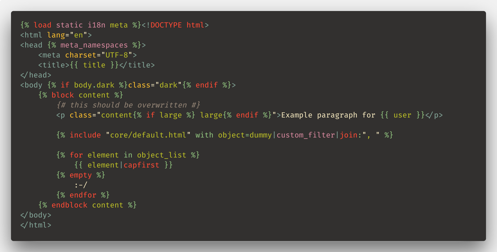

# Django extension for Visual Studio Code

> Beautiful syntax and scoped snippets for perfectionists with deadlines



## Features

### Go to definition in templates

Ctrl+click (cmd+click on MacOS) or press F12 on the template path in a `include` or `extends` tag
to jump to this template.

It also works on [django-cotton](https://django-cotton.com) components, like `<c-card>` or `<c-forms.text-input />`.
Set `django.cotton.dir` if you changed `COTTON_DIR`.

### Snippets

- Support for selected text (when inserting snippet from the menu)
- Support for copied text
- No unnecessary new lines

### Improved syntax

- Adds the filetype `django-html`
- Adds the filetype `django-txt` for email templates.
- Better syntax with more operators and default keywords:
  - Known default tags and filters
  - Known templatetags namespace from contrib in the  tag
  - Known keywords in tags, like: `as`, `asvar`, `with`, `trimmed`…
- Syntax highlighting everywhere in your HTML document:
  - In the HTML tag itself"
  - In the id, class or any attribute
  - In inline CSS or Javascript code

### Formatting

The extension can format `django-html` templates with the tool your project already uses.
Install one of them, then set `django.format.command` to a command that reads the template on stdin
and writes the result on stdout:

| Tool                                          | `django.format.command`                     | Formats                        |
| --------------------------------------------- | ------------------------------------------- | ------------------------------ |
| [djLint](https://github.com/djlint/djlint) | `["djlint", "-", "--reformat"]`             | HTML and template tags         |
| [djangofmt](https://github.com/UnknownPlatypus/djangofmt) | `["djangofmt", "-"]`            | HTML and template tags         |
| [djade](https://github.com/adamchainz/djade)  | `["djade", "-"]`                            | Template tags only             |
| [DjHTML](https://github.com/rtts/djhtml)      | `["djhtml", "-"]`                           | Indentation only               |

Tools installed in the project `.venv` are found first. Each tool reads its own configuration,
like `[tool.djlint]` in `pyproject.toml`, so the editor formats like your pre-commit hooks and CI.
Formatting runs on your machine, so it is not available in VS Code for the Web.

You can also use [Prettier](https://marketplace.visualstudio.com/items?itemName=esbenp.prettier-vscode)
with [prettier-plugin-jinja-template](https://github.com/davidodenwald/prettier-plugin-jinja-template).

## Tricks

### Gettext and internationalization

Dealing with `django.po` files?
Consider installing the [Gettext extension](https://marketplace.visualstudio.com/items?itemName=mrorz.language-gettext) by MrOrz.

### Emmet

Emmet abbreviations work in `django-html` templates out of the box.

### HTML IntelliSense in templates

Templates use the `django-html` language, so VS Code's HTML features and HTML extensions
(tag and attribute completion, auto-closing tags, Tailwind CSS, Alpine.js…) don't run on them.
To keep them, open your templates as plain HTML:

```json
"files.associations": {
    "**/templates/**/*.html": "html"
}
```

You lose the Django syntax highlighting, template snippets and go to definition in templates.

## Sponsors

- [tpberntsen](https://github.com/tpberntsen)
- [moving-content](https://github.com/moving-content)

[](https://www.paypal.com/paypalme/batisteo/5)
[](https://github.com/sponsor/batisteo)

## Contributing

### Issues

Something odd? New feature request?
Please [create an issue on Github](https://github.com/vscode-django/vscode-django/issues/new).

### Setup

```bash
git clone https://github.com/vscode-django/vscode-django
cd vscode-django
yarn install
code .
```

It’s better to have [ESLint](https://marketplace.visualstudio.com/items?itemName=dbaeumer.vscode-eslint) installed.

### Running the tests

```bash
yarn test
```

This compiles, lints, then runs the smoke tests from `src/test` in a downloaded VS Code,
with `test-fixtures` as workspace.

### Editing the grammars

The `syntaxes/*.tmLanguage.json` files are generated. Edit the TOML sources in `syntaxes/`, then run:

```bash
uv run syntaxes/build.py
```

### Releasing

1. Bump `version` in `package.json` and describe the changes in `CHANGELOG.md`, then commit and push.
2. Run `make publish`. It tags the version (`1.17` for `1.17.0`) and creates the GitHub release
   with the notes from the changelog.
3. The release triggers the [Publish workflow](.github/workflows/publish.yml), which tests,
   packages and publishes the extension to the Marketplace through
   [trusted publishing](https://code.visualstudio.com/api/working-with-extensions/publishing-extension),
   without any stored token.

### Launching the extension debugger

Make sure you have this snippet in `.vscode/launch.json`:

```javascript
{
  "version": "0.2.0",
  "configurations": [
    {
      "name": "Extension",
      "type": "extensionHost",
      "request": "launch",
      "runtimeExecutable": "${execPath}",
      "args": [
        "--extensionDevelopmentPath=${workspaceFolder}"
      ]
    }
  ]
}
```

Press <kbd>F5</kbd> or click on Debug then Start (▶️) to launch the extension host window.

Hack around

Press <kbd>Ctrl</kbd> + <kbd>Shift</kbd> + <kbd>F5</kbd> or 🔄 to reload.
